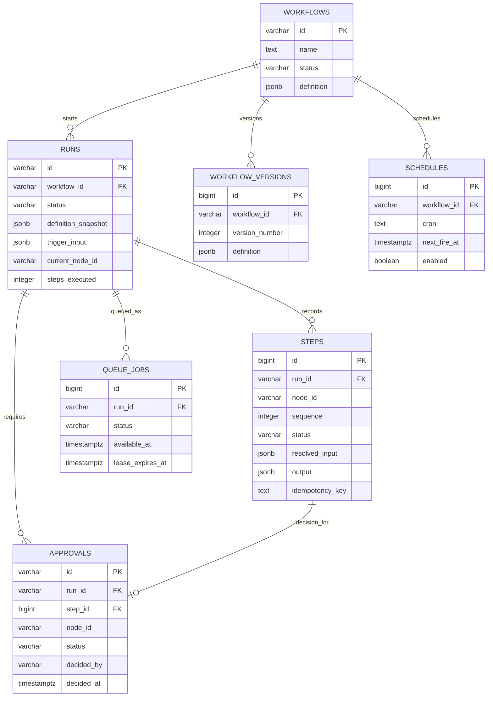

# PostgreSQL schema

PostgreSQL is the durable source of truth. Use JSONB for flexible definitions/snapshots/payloads and relational columns for querying and concurrency. Use Flyway migrations.

## 1 `workflows`
| Column | Type | Notes |
|---|---|---|
| `id` | `varchar(128)` PK | Preserve seed IDs |
| `name` | `text` | Required |
| `description` | `text` | Nullable |
| `status` | `varchar(16)` | `draft` / `published` |
| `definition` | `jsonb` | Canonical JSON |
| `created_at`, `updated_at` | `timestamptz` | Required; default to transaction time |

Constraints: `status` is restricted to `draft` or `published`; `id`, `name`, and `definition` are non-null. Seed loading inserts absent IDs as Published and does not overwrite an existing workflow on restart.

## 2 `workflow_versions` (optional Good To Have)
| Column | Type | Notes |
|---|---|---|
| `id` | `bigserial` PK | Surrogate ID |
| `workflow_id` | `varchar(128)` FK | Workflow |
| `version_number` | `integer` | Unique per workflow |
| `definition` | `jsonb` | Immutable version |
| `created_at` | `timestamptz` | Required |
Unique `(workflow_id, version_number)`. This table is optional and is not part of the initial Must Have migration. Run snapshots remain mandatory without it.

## 3 `runs`
| Column | Type | Notes |
|---|---|---|
| `id` | `varchar(128)` PK | Run ID |
| `workflow_id` | `varchar(128)` FK | Workflow |
| `definition_snapshot` | `jsonb` | Immutable run definition |
| `status` | `varchar(24)` | Check six allowed statuses |
| `trigger_type` | `varchar(16)` | `manual`, `webhook`, `schedule` |
| `trigger_input` | `jsonb` | `trigger.body` |
| `current_node_id` | `varchar(128)` | Nullable |
| `steps_executed` | `integer` | Non-negative |
| `ai_tokens_used` | `bigint` | Non-negative |
| `error` | `jsonb` | Nullable structured failure |
| `cancel_requested` | `boolean` | Default false |
| `started_at`, `finished_at` | `timestamptz` | Nullable |
| `created_at`, `updated_at` | `timestamptz` | Required |
Constraints: `status` is one of `queued`, `running`, `waiting_approval`, `succeeded`, `failed`, `cancelled`; `trigger_type` is one of `manual`, `webhook`, `schedule`; counters are non-negative. Foreign-key deletion must not remove a workflow with run history.
Indexes: `(workflow_id, created_at DESC)`, `(status, created_at)`.

## 4 `steps`
| Column | Type | Notes |
|---|---|---|
| `id` | `bigserial` PK | Row ID |
| `run_id` | `varchar(128)` FK | Parent run |
| `node_id` | `varchar(128)` | Graph node |
| `node_type` | `varchar(64)` | Catalog type |
| `sequence` | `integer` | Execution order; unique per run |
| `status` | `varchar(24)` | `running`, `waiting`, `succeeded`, `failed`, `cancelled` |
| `attempt` | `integer` | Attempt count, at least 1 |
| `resolved_input` | `jsonb` | Resolved parameters |
| `output` | `jsonb` | Nullable output |
| `error` | `jsonb` | Nullable error |
| `idempotency_key` | `text` | Nullable for non-side-effect |
| `tokens_prompt`, `tokens_completion` | `integer` | Nullable |
| `started_at`, `finished_at` | `timestamptz` | Nullable |
| `duration_ms` | `bigint` | Nullable |
Unique `(run_id, sequence)`; that unique constraint supplies the run/sequence index, so do not create a duplicate index. Do not make `(run_id,node_id)` unique because loops revisit nodes. Use positive sequences and non-negative token/duration values. Keep one row per logical node execution sequence; retries share that row and increment `attempt`.

## 5 `approvals`
| Column | Type | Notes |
|---|---|---|
| `id` | `varchar(128)` PK | Approval ID |
| `run_id` | `varchar(128)` FK | Parent run |
| `step_id` | `bigint` FK | Unique reference to the approval node's step; ties the decision to its execution order |
| `node_id` | `varchar(128)` | Approval node |
| `message` | `text` | Resolved message |
| `status` | `varchar(16)` | `pending`, `approved`, `rejected`, optionally `cancelled` |
| `decided_by` | `varchar(128)` | Nullable while pending |
| `decided_at` | `timestamptz` | Nullable while pending |
| `reason` | `text` | Optional rejection reason |
| `created_at` | `timestamptz` | Required |
Indexes: `(status, created_at)`, `(run_id,node_id)`. A composite foreign key requires `step_id` and `node_id` to identify a step in the same run. Use a row lock or conditional update to ensure one decision. The engine can join to the step sequence to prove the approval occurred before a sensitive action. `cancelled` closes a pending approval when its run is cancelled; it is not a run status.

## 6 `queue_jobs`
| Column | Type | Notes |
|---|---|---|
| `id` | `bigserial` PK | Job ID |
| `run_id` | `varchar(128)` FK, unique | One reusable queue job per run |
| `status` | `varchar(16)` | `queued`, `leased`, `completed`, `cancelled` |
| `available_at` | `timestamptz` | Ready/delay/backoff time |
| `lease_owner` | `varchar(128)` | Nullable worker ID |
| `lease_expires_at` | `timestamptz` | Nullable |
| `attempts` | `integer` | Non-negative claim attempts |
| `last_error` | `text` | Nullable |
| `created_at`, `updated_at` | `timestamptz` | Required |
Indexes: partial ready-job index on `(available_at, id)` for queued rows and lease-expiry index for leased rows. A single row is rescheduled for delays/retries and cannot represent concurrent jobs for one run. Lease owner and expiry are both present only while `leased`.

## 7 `schedules` (Good To Have; not in initial migration)
`id bigserial PK`, `workflow_id varchar(128) FK`, `cron text`, `next_fire_at timestamptz`, `enabled boolean`, `created_at timestamptz`, `updated_at timestamptz`. Poll at short intervals with 1-minute granularity; each fire creates a normal run.

## 8 Entity relationship diagram

## 9 Transaction boundaries and invariants
- `runs.definition_snapshot` never changes after trigger.
- `steps.sequence` unique per run and increments per node execution.
- Steps are append-mostly; trace must show attempts even if attempts are stored within one step record.
- Trigger transaction: insert run + snapshot + queue job.
- Approval transaction: decide approval + update run/queue state.
- Step completion transaction: persist output + advance run + reschedule/complete job.
- Claim transaction: acquire lease atomically.
- Never hold a long DB transaction across external HTTP calls or delays.

## 10 Initial migration scope

The initial Flyway migration creates `workflows`, `runs`, `steps`, `approvals`, and `queue_jobs`, plus the constraints and indexes above. `workflow_versions` and `schedules` remain Good To Have and are intentionally excluded. Seed insertion should run as one transaction and use conflict-safe inserts. The SQL migration is the executable schema source; keep this reference and `docs/DATA_MODEL.md` aligned with it.
